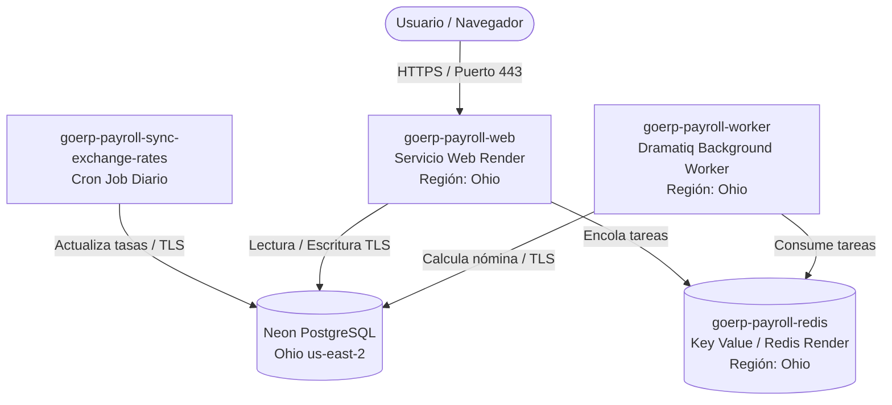

# Despliegue en Render con Base de Datos Neon PostgreSQL

Esta guía explica cómo desplegar GoERP Payroll en producción utilizando la plataforma PaaS [Render](https://render.com) conectada a una base de datos externa [Neon PostgreSQL](https://neon.tech) mediante el archivo de Blueprint [`render.yaml`](../../render.yaml).

---

## Arquitectura en Render + Neon

El archivo [`render.yaml`](../../render.yaml) aprovisiona la capa de aplicación y cola en Render (Región **Ohio / us-east-2**, coincidiendo con la ubicación de Neon para mínima latencia):



1. **Base de Datos Externa ([Neon PostgreSQL](https://neon.tech))**: PostgreSQL serverless en `us-east-2` (Ohio). El motor de GoERP Payroll detecta automáticamente el host `neon.tech` y habilita conexión segura SSL/TLS.
2. **Cola y Caché (`goerp-payroll-redis`)**: Instancia Key Value / Redis en Render (Ohio) para gestión de tareas asíncronas con Dramatiq y sesiones de usuario con política `noeviction`.
3. **Servicio Web (`goerp-payroll-web`)**: Contenedor Docker basado en el [`Dockerfile`](../../Dockerfile), con Waitress WSGI y verificación de salud en `/health`.
4. **Worker en Segundo Plano (`goerp-payroll-worker`)**: Procesa asíncronamente los cálculos masivos de nómina y la generación de recibos PDF.
5. **Cron Job de Mantenimiento (`goerp-payroll-sync-exchange-rates`)**: Ejecución programada diaria (06:15 UTC) para sincronizar tipos de cambio.

---

## Parámetros de Conexión Configurados

* **Región de Despliegue:** `ohio` (AWS `us-east-2`, misma región del pooler de Neon).
* **Base de Datos:**
  * Host: `ep-damp-bread-b4fq1gik-pooler.c-6.us-east-2.aws.neon.tech`
  * Base de datos: `neondb`
  * Usuario: `neondb_owner`
* **Credenciales de Administrador de la Aplicación Web:**
  * **Usuario**: `admin`
  * **Contraseña**: `NeonAdminPassword2026!`

---

## Paso a Paso para el Despliegue

### 1. Conectar el Blueprint en Render

1. Inicie sesión en el [Dashboard de Render](https://dashboard.render.com).
2. En la barra superior, haga clic en **New +** y seleccione **Blueprint**.
3. Seleccione el repositorio de Git que contiene GoERP Payroll.
4. Render leerá automáticamente el archivo [`render.yaml`](../../render.yaml) y le mostrará los servicios a crear:
   - Redis Key-Value (`goerp-payroll-redis` en Ohio)
   - Servicio Web (`goerp-payroll-web` en Ohio)
   - Background Worker (`goerp-payroll-worker` en Ohio)
   - Cron Job (`goerp-payroll-sync-exchange-rates` en Ohio)
   - Grupo de variables compartidas (`goerp-payroll-shared`)
5. Haga clic en **Apply**.

Render compilará la imagen Docker e inicializará los servicios conectados a su base de datos Neon.

---

## Inicialización y Migraciones de Base de Datos

Al iniciar el contenedor por primera vez contra su base de datos Neon, el entrypoint ejecuta automáticamente:
```bash
payrollctl database init
payrollctl database migrate
```
Esto creará o actualizará todas las tablas requeridas en su base de datos Neon de manera transparente.

---

## Acceso Inicial a la Aplicación

Una vez que el servicio `goerp-payroll-web` esté en estado **Live**:
1. Abra la URL `.onrender.com` asignada por Render.
2. Inicie sesión con:
   - **Usuario**: `admin`
   - **Contraseña**: `NeonAdminPassword2026!`
