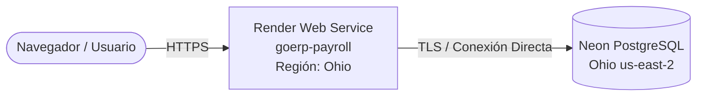

# Despliegue en Render como Servicio Web (Sin Blueprints de Pago)

Esta guía explica cómo desplegar GoERP Payroll en [Render](https://render.com) como un **único Servicio Web (Web Service)** conectado directamente a su base de datos **Neon PostgreSQL**, sin necesidad de contratar Blueprints de pago ni servicios adicionales (como Redis o workers dedicados).

---

## Arquitectura Simplificada



* **Servidor Web:** Ejecuta la aplicación Flask + Waitress dentro de un contenedor Docker.
* **Base de Datos:** Se conecta a su base de datos externa en Neon (`us-east-2`).
* **Cálculos de Nómina:** Se ejecutan de manera síncrona (`QUEUE_ENABLED=0`), por lo que **no requiere Redis ni contenedores worker adicionales**.
* **Costo:** Puede ejecutarse en el plan **Free** o **Starter** de Render.

---

## Opción A: Despliegue con Blueprint (`render.yaml`)

El repositorio incluye un archivo [`render.yaml`](../../render.yaml) configurado para desplegar el servicio web en el plan gratuito con `sync: false` para las credenciales sensibles.

1. En el [Dashboard de Render](https://dashboard.render.com), haga clic en **New +** → **Blueprint**.
2. Conecte este repositorio.
3. Render leerá `render.yaml` y le solicitará ingresar de forma segura en la interfaz web:
   - `DATABASE_URL`: Cadena de conexión provista por Neon.
   - `ADMIN_PASSWORD`: Contraseña para el usuario administrador inicial.
4. Haga clic en **Apply** para iniciar el despliegue.

---

## Opción B: Despliegue Manual Paso a Paso

Si prefiere crear el servicio manualmente sin Blueprint:

### 1. Crear el Nuevo Servicio Web

1. Inicie sesión en su cuenta de [Render Dashboard](https://dashboard.render.com).
2. En la esquina superior derecha, haga clic en el botón azul **New +** y seleccione **Web Service**.
3. En la lista de repositorios, busque y seleccione el repositorio de **GoERP Payroll** (haga clic en **Connect**).

---

### 2. Configuración Principal del Servicio

Complete los siguientes campos en el formulario de Render:

| Campo | Valor Recomendado | Explicación |
| :--- | :--- | :--- |
| **Name** | `goerp-payroll` | Nombre identificador de su servicio y URL (`goerp-payroll.onrender.com`). |
| **Region** | **Ohio (US East)** | **Importante:** Seleccione Ohio para que esté en el mismo centro de datos AWS (`us-east-2`) que Neon, minimizando la latencia. |
| **Branch** | `main` (o su rama activa) | Rama de Git a desplegar. |
| **Language / Runtime** | **Docker** | Render detectará automáticamente el archivo [`Dockerfile`](../../Dockerfile) en la raíz. |
| **Instance Type** | **Free** (o Starter) | Seleccione **Free** para pruebas sin costo. |

---

### 3. Configuración Avanzada (Health Check)

Despliegue la sección **Advanced** al final de la página y configure:

* **Health Check Path:** `/health`

---

### 4. Variables de Entorno (Environment Variables)

En la sección **Environment Variables**, agregue las siguientes variables (haga clic en **Add Environment Variable** para cada una):

| Clave (Key) | Valor (Value) | Explicación |
| :--- | :--- | :--- |
| `FLASK_ENV` | `production` | Entorno de ejecución productivo. |
| `PROCESS_ROLE` | `web` | Inicia el servicio web Flask + Waitress. |
| `QUEUE_ENABLED` | `0` | Ejecuta cálculos en modo directo/síncrono (sin Redis). |
| `ADMIN_USER` | `admin` | Nombre de usuario inicial para la interfaz de administración. |
| `ADMIN_PASSWORD` | *(Defina una contraseña segura)* | Contraseña que usará para iniciar sesión. |
| `DATABASE_URL` | `postgresql://neondb_owner:<PASSWORD>@<HOST>/neondb?sslmode=require` | Cadena de conexión obtenida de su panel de Neon. |
| `SECRET_KEY` | *(Cadena aleatoria secreta)* | Clave criptográfica para firmas de sesión Flask. |

---

### 5. Desplegar y Verificar

1. Haga clic en el botón **Create Web Service** al final de la página.
2. Render comenzará a compilar la imagen Docker. Durante el primer inicio, el entrypoint ejecutará automáticamente:
   ```bash
   payrollctl database init
   payrollctl database migrate
   ```
   inicializando las tablas en su base de datos Neon.
3. Una vez que el estado cambie a **Live**, haga clic en la URL asignada (`https://goerp-payroll-xxxx.onrender.com`).
4. Inicie sesión con:
   * **Usuario:** `admin` (o el valor asignado a `ADMIN_USER`)
   * **Contraseña:** La contraseña que configuró en `ADMIN_PASSWORD`.
