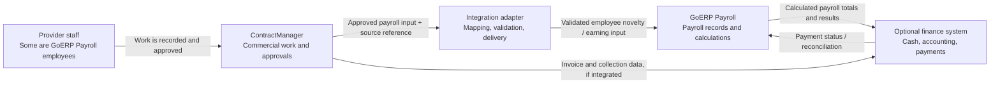
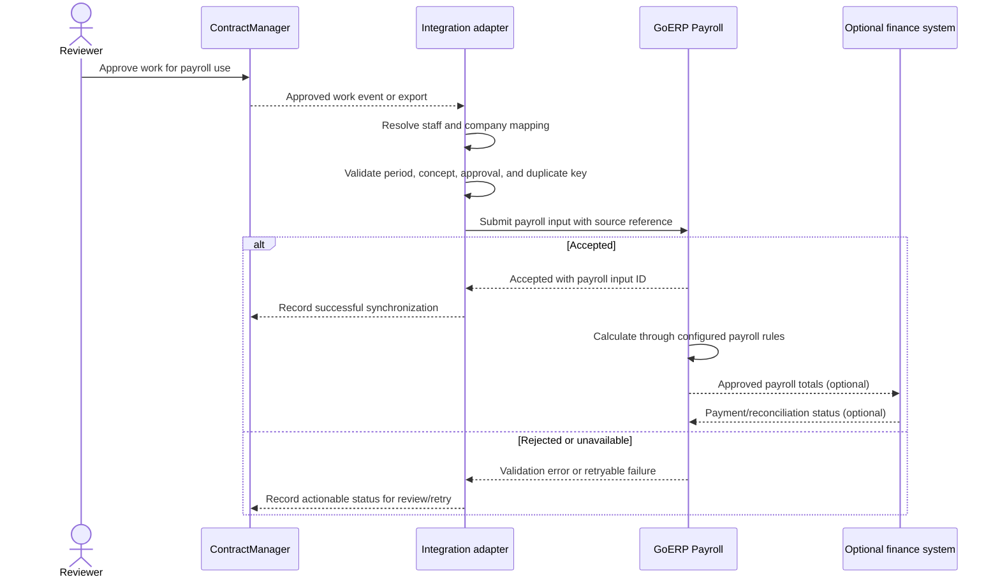
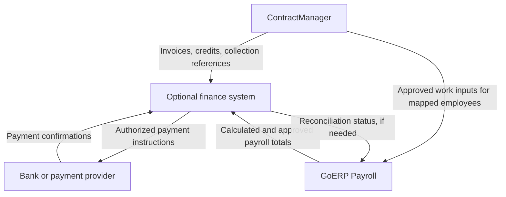

# Integration Architecture Proposal

## Purpose and intent

This document proposes how to connect ContractManager and GoERP Payroll while keeping them as independently developed and operated projects.

ContractManager tracks commercial and operational work: contracts, service concepts, solicitations, technical proposals, purchase orders, daily reports, estimates, and invoices. GoERP Payroll manages employees, configurable payroll concepts, payroll rules, and payroll runs. Some people recorded as Provider staff in ContractManager may also be employees whose compensation is processed in GoERP Payroll.

The intended integration is to transfer **approved, payroll-relevant work inputs** for those people into GoERP Payroll. ContractManager's billed prices and invoice totals are commercial amounts; they are not automatically employee wages. GoERP Payroll remains responsible for calculating payroll according to its configured rules.

This is a proposal, not a description of an integration that is already implemented. ContractManager's current README does not document an API, and GoERP Payroll's integration API documentation does not describe the complete work-approval-to-payroll workflow. Confirm or build the required interfaces before relying on this design.

## Recommended system boundaries

| System | Owns and remains authoritative for |
|---|---|
| ContractManager | Contracts, service concepts, locations, purchase orders, work reports, approvals, estimates, and invoices |
| GoERP Payroll | Employee payroll records, payroll configuration, calculation rules, payroll runs, and payroll results |
| Optional finance system | Receivables, collections, cash position, budgets, accounting, disbursements, and payment reconciliation |
| Integration adapter | Identity mapping, validation, delivery, retries, and cross-system references; it does not own payroll or commercial rules |

Keep the applications, repositories, and databases separate. Integrate at explicit API or file-exchange boundaries rather than sharing tables or allowing one application's migrations to depend on another's schema.

### System context



The finance system is optional. It may help manage available funds and payment execution, but cash collected for a contract does not by itself determine an employee's wages or whether an earning is valid.

## Proposed payroll-input flow

1. ContractManager records work against a purchase order, concept, period, and Provider staff member.
2. The relevant work or estimate is reviewed and explicitly approved for payroll use. Approval should be distinct from simply recording a report or issuing an invoice.
3. The integration resolves the ContractManager staff identity to a GoERP Payroll employee and verifies the company, earning period, approval status, and compensation mapping.
4. It sends a payroll input to GoERP Payroll, such as approved hours, units, commission basis, or a monetary amount. The applicable earning concept and calculation remain configured in GoERP Payroll.
5. GoERP Payroll validates and processes the input in the appropriate payroll run. Payroll staff review the resulting calculations before approval and payment.
6. The integration records the GoERP Payroll result or rejection against the originating ContractManager record so both sides can be reconciled.

### Sequence



The exact GoERP Payroll endpoint or import format must be confirmed. GoERP Payroll's [integration API guide](./integrations-api.md) currently describes a subset of API operations, including reading payroll-related data and creating novelties; the complete integration contract may require additional endpoints or a controlled import workflow.

## Data-mapping principles

- **Explicit identity mapping:** Maintain a durable mapping from ContractManager Provider staff ID to GoERP Payroll employee ID. Do not match payroll recipients by name alone. Confirm that the person is an employee of the relevant payroll company.
- **Explicit earning mapping:** Map approved work types or concepts to configured GoERP Payroll earning concepts. ContractManager service concepts and their client billing prices are not payroll concepts by default.
- **Separate commercial and compensation values:** Define how the employee compensation basis is established (for example, approved hours, units, a configured rate, or an agreed commission formula). Do not infer wages from invoice totals or collected cash.
- **Preserve provenance:** Include the source application, source record ID, approval reference, work period, and relevant version or correction reference with each imported input.
- **Use stable company identifiers:** Map ContractManager client/provider organizations to the appropriate GoERP Payroll company explicitly; do not assume every client, Provider, or staff record has a payroll counterpart.
- **Minimize personal data:** Send only the information needed to identify the employee and calculate the approved earning. Avoid copying contracts or unrelated staff information into payroll.

An illustrative integration message could contain:

```json
{
  "source_system": "contractmanager",
  "source_record_id": "approved-work-record-id",
  "source_version": 1,
  "provider_staff_id": "provider-staff-id",
  "goerp_employee_id": "mapped-employee-id",
  "goerp_company_id": "mapped-company-id",
  "earning_code": "configured-earning-code",
  "period_start": "YYYY-MM-DD",
  "period_end": "YYYY-MM-DD",
  "quantity": 0,
  "unit": "configured-unit",
  "approved_at": "ISO-8601 timestamp"
}
```

This is a conceptual example, not a currently supported ContractManager or GoERP Payroll request schema. The sender and receiver should agree on field names, units, precision, time zones, validation rules, and versioning before implementation.

## Reliability, security, and controls

- Authenticate integrations with dedicated credentials, least-privilege scopes, rotation, and revocation. Do not reuse a human user's session or share credentials between environments.
- Enforce company-level authorization and validate that the mapped employee is eligible for the selected company and period.
- Use an idempotency key derived from the source system, source record, and source version so retries do not create duplicate earnings.
- Distinguish retryable delivery failures from business validation failures. Retain rejected records with a reason and a clear path for authorized correction.
- Treat changes to an approved record as versioned corrections. Define how to handle changes before payroll closes and adjustments after payroll has been approved or paid; never silently overwrite a finalized payroll result.
- Log who approved the work, when it was sent, what GoERP Payroll accepted or rejected, and any subsequent correction. Restrict log access and avoid logging credentials or unnecessary personal data.
- Reconcile counts and totals by period and company. Operational reports should surface pending, rejected, duplicated, and successfully imported records.
- Keep payroll approval and payment authorization in their designated systems. An integration may transmit inputs or statuses, but should not bypass review controls.

## Optional finance-system role

Introduce a finance system only if the workflow needs capabilities such as accounts receivable, collection tracking, budgets, accounting, payment execution, or bank reconciliation. Otherwise, a small integration adapter may be enough.



The finance system can inform funding and execute or reconcile payments, but it should not decide whether approved work constitutes wages. Contractual compensation terms and configured payroll rules determine pay; financial availability is a separate control.

## Advantages and disadvantages

| Advantages | Disadvantages and risks |
|---|---|
| Each project keeps a clear purpose and independent release cycle. | API contracts, identity mapping, credentials, and monitoring add implementation and operational work. |
| No shared schema or cross-project database migrations are required. | Data can arrive late, out of order, or more than once unless retries and idempotency are designed carefully. |
| ContractManager remains focused on commercial execution, while GoERP Payroll remains responsible for payroll calculations. | Mapping Provider staff to employees and matching concepts to configured earnings require explicit governance and maintenance. |
| Approved work can provide traceable, structured inputs to payroll instead of manual re-entry. | Approval mistakes or incorrect mappings can affect pay; validation, review, and reconciliation are essential. |
| A finance system can be added later without making it the payroll calculation engine. | A third system increases security, access-control, support, and data-consistency responsibilities. |
| Systems can be deployed or replaced independently behind stable integration contracts. | Changes after payroll close need a deliberate correction process and may require off-cycle adjustments. |
| Data sharing can be limited to the minimum needed for the workflow. | Separate user experiences may remain until a shared portal or single sign-on is added separately. |

## Suggested implementation phases

1. **Agree on the business rules:** Decide which approved work types can affect payroll, who can approve them, what compensation basis applies, and how corrections are handled.
2. **Define identity and earning mappings:** Establish company and staff cross-references, earning codes, effective dates, and ownership of each mapping.
3. **Pilot a controlled import:** Use a small, reviewed batch of approved work inputs. Reconcile source records with GoERP Payroll results before automating further.
4. **Automate delivery safely:** Add authentication, idempotency, retries, monitoring, actionable rejection handling, and audit records.
5. **Add finance integration only when justified:** Connect invoices, collections, budgets, payment execution, and reconciliation as a separate capability with its own controls.

## Decision

Keep ContractManager, GoERP Payroll, and any future finance system as separate applications with separate data ownership. Connect them through documented, versioned interfaces. The first integration should transfer only approved, employee-specific payroll inputs; GoERP Payroll should remain the authority for payroll calculations. Add a finance system only to meet genuine finance and payment-management needs, not merely as a conduit for work records.
