# Modelo de datos de nómina

Este diagrama resume las entidades principales del flujo de configuración y ejecución de nómina. Está basado en las claves foráneas y tablas de asociación declaradas en `goerp_payroll/model.py`; no representa todas las tablas de módulos auxiliares, auditoría e integración.

Todos los modelos que heredan de `BaseTabla` tienen un `id` ULID de 26 caracteres como clave primaria, además de campos comunes de auditoría. Las tablas de asociación `empresa_*` son tablas puente con clave primaria compuesta y no heredan esos campos.

Para el uso funcional, consulte las guías de [empresas](../guia/empresas.md), [empleados](../guia/empleados.md), [planillas](../guia/planillas.md), [ejecución de nómina](../guia/nomina.md) y [componentes de cálculo](../guia/percepciones.md).

```mermaid
erDiagram
    EMPRESA {
        string id PK
        string codigo UK
        string razon_social
    }
    MONEDA {
        string id PK
        string codigo UK
        string nombre
    }
    TIPO_PLANILLA {
        string id PK
        string codigo UK
        string periodicidad
    }
    EMPLEADO {
        string id PK
        string empresa_id FK "nullable"
        string moneda_id FK "nullable"
        string identificacion_personal UK
        decimal salario_base
        decimal salario_acumulado
        decimal impuesto_acumulado
    }
    PLANILLA {
        string id PK
        string empresa_id FK "nullable"
        string tipo_planilla_id FK
        string moneda_id FK
        string nombre UK
    }
    PERCEPCION {
        string id PK
        string codigo UK
        string nombre
    }
    DEDUCCION {
        string id PK
        string codigo UK
        string nombre
    }
    PRESTACION {
        string id PK
        string codigo UK
        string nombre
    }
    REGLA_CALCULO {
        string id PK
        string codigo
        string version
        string percepcion_id FK "nullable"
        string deduccion_id FK "nullable"
        string prestacion_id FK "nullable"
    }
    PLANILLA_EMPLEADO {
        string id PK
        string planilla_id FK
        string empleado_id FK
        date fecha_inicio
        date fecha_fin
    }
    PLANILLA_INGRESO {
        string id PK
        string planilla_id FK
        string percepcion_id FK
    }
    PLANILLA_DEDUCCION {
        string id PK
        string planilla_id FK
        string deduccion_id FK
        int prioridad
    }
    PLANILLA_PRESTACION {
        string id PK
        string planilla_id FK
        string prestacion_id FK
    }
    PLANILLA_REGLA_CALCULO {
        string id PK
        string planilla_id FK
        string regla_calculo_id FK
        int orden
    }
    NOMINA {
        string id PK
        string planilla_id FK
        date periodo_inicio
        date periodo_fin
        string estado
    }
    NOMINA_EMPLEADO {
        string id PK
        string nomina_id FK
        string empleado_id FK
        decimal salario_bruto
        decimal salario_neto
    }
    NOMINA_DETALLE {
        string id PK
        string nomina_empleado_id FK
        string percepcion_id FK "nullable"
        string deduccion_id FK "nullable"
        string prestacion_id FK "nullable"
        decimal monto
    }
    NOMINA_NOVEDAD {
        string id PK
        string nomina_id FK "nullable"
        string empleado_id FK
        string percepcion_id FK "nullable"
        string deduccion_id FK "nullable"
        decimal valor_cantidad
    }
    HISTORIAL_SALARIO {
        string id PK
        string empleado_id FK
        date fecha_efectiva
        decimal salario_anterior
        decimal salario_nuevo
    }
    EMPRESA_PERCEPCION {
        string empresa_id PK, FK
        string concept_id PK, FK
    }
    EMPRESA_DEDUCCION {
        string empresa_id PK, FK
        string concept_id PK, FK
    }
    EMPRESA_PRESTACION {
        string empresa_id PK, FK
        string concept_id PK, FK
    }

    EMPRESA o|--o{ EMPLEADO : "asigna"
    MONEDA o|--o{ EMPLEADO : "denomina salario"
    EMPRESA o|--o{ PLANILLA : "configura"
    TIPO_PLANILLA ||--o{ PLANILLA : "clasifica"
    MONEDA ||--o{ PLANILLA : "denomina"

    PLANILLA ||--o{ PLANILLA_EMPLEADO : "incluye"
    EMPLEADO ||--o{ PLANILLA_EMPLEADO : "se asigna"
    PLANILLA ||--o{ PLANILLA_INGRESO : "configura"
    PERCEPCION ||--o{ PLANILLA_INGRESO : "se incluye"
    PLANILLA ||--o{ PLANILLA_DEDUCCION : "configura"
    DEDUCCION ||--o{ PLANILLA_DEDUCCION : "se incluye"
    PLANILLA ||--o{ PLANILLA_PRESTACION : "configura"
    PRESTACION ||--o{ PLANILLA_PRESTACION : "se incluye"
    PLANILLA ||--o{ PLANILLA_REGLA_CALCULO : "usa"
    REGLA_CALCULO ||--o{ PLANILLA_REGLA_CALCULO : "se aplica"

    PLANILLA ||--o{ NOMINA : "genera ejecuciones"
    NOMINA ||--o{ NOMINA_EMPLEADO : "procesa"
    EMPLEADO ||--o{ NOMINA_EMPLEADO : "participa"
    NOMINA_EMPLEADO ||--o{ NOMINA_DETALLE : "desglosa"
    PERCEPCION o|--o{ NOMINA_DETALLE : "origina"
    DEDUCCION o|--o{ NOMINA_DETALLE : "origina"
    PRESTACION o|--o{ NOMINA_DETALLE : "origina"
    NOMINA o|--o{ NOMINA_NOVEDAD : "recibe novedades"
    EMPLEADO ||--o{ NOMINA_NOVEDAD : "tiene"
    PERCEPCION o|--o{ NOMINA_NOVEDAD : "referencia"
    DEDUCCION o|--o{ NOMINA_NOVEDAD : "referencia"
    EMPLEADO ||--o{ HISTORIAL_SALARIO : "mantiene historial"

    EMPRESA ||--o{ EMPRESA_PERCEPCION : "habilita"
    PERCEPCION ||--o{ EMPRESA_PERCEPCION : "se habilita para"
    EMPRESA ||--o{ EMPRESA_DEDUCCION : "habilita"
    DEDUCCION ||--o{ EMPRESA_DEDUCCION : "se habilita para"
    EMPRESA ||--o{ EMPRESA_PRESTACION : "habilita"
    PRESTACION ||--o{ EMPRESA_PRESTACION : "se habilita para"
    PERCEPCION o|--o{ REGLA_CALCULO : "asocia regla"
    DEDUCCION o|--o{ REGLA_CALCULO : "asocia regla"
    PRESTACION o|--o{ REGLA_CALCULO : "asocia regla"
```

## Cómo interpretar el modelo

- Una `PLANILLA` agrupa empleados y componentes mediante tablas puente. Estas asociaciones guardan datos propios, como vigencia, prioridad, orden y valores predeterminados.
- Una `NOMINA` es una ejecución de una planilla para un período. `NOMINA_EMPLEADO` guarda los totales por persona y `NOMINA_DETALLE` conserva los conceptos calculados.
- `NOMINA_NOVEDAD` almacena novedades de empleados; puede registrarse antes de asociarse a una ejecución, por eso `nomina_id` admite valores nulos.
- Los catálogos de percepciones, deducciones y prestaciones son compartidos. Las tablas `EMPRESA_*` representan su habilitación opcional por empresa.
- Las columnas marcadas como `nullable` en el diagrama reflejan claves foráneas opcionales en el modelo; las demás claves foráneas mostradas son obligatorias.
